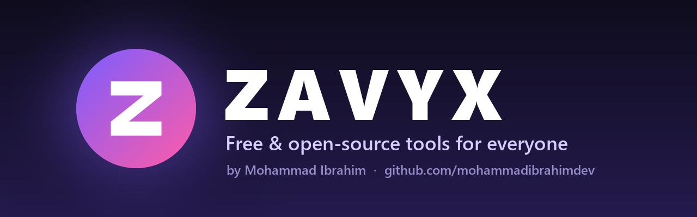
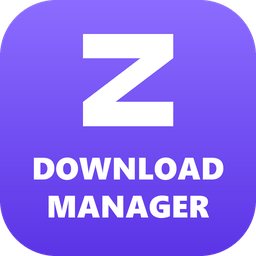
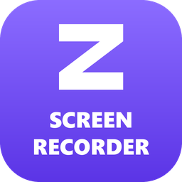
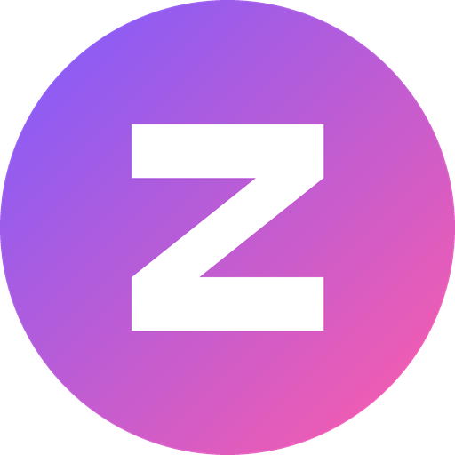

  

  <b>Zavyx</b> is a family of free, open-source desktop tools — built to be simple, fast and respectful of your privacy. 
  No ads. No trials. No tracking. Just useful software you can read, trust and improve.

  

---

## 🧰 Tools

<table>
  <tr>
    <td width="140" align="center" valign="top">
      
    </td>
    <td valign="top">
      <h3><a href="https://github.com/mohammadibrahimdev/zavyx-download-manager">Zavyx Download Manager</a> · Zavyx DM</h3>
      Fast multi-connection downloads with pause &amp; resume, one-click video downloads from YouTube and 1000+ sites,
      and a browser extension for Chrome, Edge, Brave, Opera and Firefox.  
      
      
      
        
      <a href="https://github.com/mohammadibrahimdev/zavyx-download-manager/releases/latest"><b>⬇ Download</b></a>
      &nbsp;·&nbsp;
      <a href="https://github.com/mohammadibrahimdev/zavyx-download-manager">Source code</a>
      &nbsp;·&nbsp;
      <a href="https://github.com/mohammadibrahimdev/zavyx-download-manager/issues">Report a bug</a>
    </td>
  </tr>
  <tr>
    <td width="140" align="center" valign="top">
      
    </td>
    <td valign="top">
      <h3><a href="https://github.com/mohammadibrahimdev/zavyx-screen-recorder">Zavyx Screen Recorder</a> · Zavyx SR</h3>
      Record your screen, a window, games, your webcam or sound only — with system audio and microphone in sync,
      drawing on the screen while recording, no watermark and no time limit.  
      
      
      
        
      <a href="https://github.com/mohammadibrahimdev/zavyx-screen-recorder/releases/latest"><b>⬇ Download</b></a>
      &nbsp;·&nbsp;
      <a href="https://github.com/mohammadibrahimdev/zavyx-screen-recorder">Source code</a>
      &nbsp;·&nbsp;
      <a href="https://github.com/mohammadibrahimdev/zavyx-screen-recorder/issues">Report a bug</a>
    </td>
  </tr>
  <tr>
    <td width="140" align="center" valign="top">
      
    </td>
    <td valign="top">
      <h3><a href="https://github.com/mohammadibrahimdev/zavyx-video-editor">Zavyx Video Editor</a> · Zavyx VE</h3>
      Edit videos on a multi-track timeline with titles, 30 transitions, 40+ effects and filters, colour and
      keyframe animation, then export to MP4 — no watermark, for 64-bit and 32-bit Windows.  
      
      
      
        
      <a href="https://github.com/mohammadibrahimdev/zavyx-video-editor/releases/latest"><b>⬇ Download</b></a>
      &nbsp;·&nbsp;
      <a href="https://github.com/mohammadibrahimdev/zavyx-video-editor">Source code</a>
      &nbsp;·&nbsp;
      <a href="https://github.com/mohammadibrahimdev/zavyx-video-editor/issues">Report a bug</a>
    </td>
  </tr>
  <tr>
    <td width="140" align="center" valign="middle">
      
    </td>
    <td valign="middle">
      <h3>More tools on the way…</h3>
      New Zavyx tools will appear here. Have an idea for one? <a href="https://github.com/mohammadibrahimdev/zavyx/issues">Suggest it</a>.
    </td>
  </tr>
</table>

## 💜 What every Zavyx tool promises

| | |
| --- | --- |
| **Free forever** | No paid tiers, no trial timers, no nag screens. |
| **Open source** | All code is public under the MIT licence — read it, build it, improve it. |
| **Private** | No ads, no analytics, no data leaves your computer unless you ask it to. |
| **Simple** | Clean, familiar interfaces that just work for everyday users. |

## 👤 About

Zavyx is made by **Mohammad Ibrahim** — [github.com/mohammadibrahimdev](https://github.com/mohammadibrahimdev).

Want to help? Star a project ⭐, report bugs, suggest features, or send a pull request to any Zavyx repository.

  

